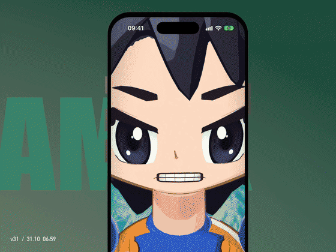

# Saiyan Awakening: Goku vs Frieza

A just-for-fun iPhone demo, made because I love Goku: hold to charge your Ki, then watch chibi Goku power up on Namek,
go Super Saiyan, dodge Frieza's Death Beam and finish with a Kamehameha over the sea.



- **Promo clip:** [`render/promo/saiyan-awakening-demo.mp4`](render/promo/saiyan-awakening-demo.mp4) (41 s, 4:3, 60 fps, with sound),
  frame grid: [`render/promo/saiyan-awakening-sheet.jpg`](render/promo/saiyan-awakening-sheet.jpg)
- **Author:** Hoa Hoang ([@novahoangdev](https://x.com/novahoangdev)), from [@vgangstudio](https://x.com/vgangstudio) with love
- **Built:** 29–31 October 2026, 31 iterated versions; release notes for each one are in [`versions/`](versions/README.md)

A ~34-second cinematic for iPhone. Blender renders the 3D part into a single "pack" video (color + Goku matte + energy layer + depth);
the React Native app draws aura, lightning, beams, explosions, speed lines and more in real time with Skia v3 on top of that same video, while Reanimated keeps
a 120 Hz clock and drives haptics. Detailed design: [PLAN.md](PLAN.md).

## Structure

```
blender/scripts/build_scene.py    builds the whole scene in code: Namek, Goku/Frieza, choreography, 10 camera shots, FX tracks, markers
blender/scripts/face_textures.py  draws anime faces (eyes, lashes, mouth, cheeks) with SDF + numpy → blender/textures/*.png
blender/textures/                 face textures + hand-painted sky / ground / sea (generated with Codex image gen)
blender/scripts/render_passes.py  renders 4 passes: beauty / matte / energy / depth
blender/scripts/bake_timeline.py  exports app/assets/cinematic/timeline.json (2D anchors, FX tracks, markers)
blender/scripts/kamehameha.py     the Kamehameha sequence: cupped hands, energy ball, beam, sea ripples and spray, water-crown explosion
blender/scripts/retime.py         stretches the 20 s block-out shot by shot into the ~34 s film (all keyframes, markers, node trees)
blender/scripts/secondary.py      secondary motion after retime: hair / tail / belt springs, grass and tree wind, leaves, beam impacts
blender/scripts/char_outlines.py  character outlines whose width follows camera distance and body part
blender/scripts/extras/           per-area detail passes (Goku outfit and details, Frieza details and form, environment)
blender/scripts/promo.py          builds the 4:3 phone-mockup promo clip for X
blender/scripts/synth_audio.py    synthesizes music + SFX with numpy from the markers → render/audio/mix.wav
tools/pack.sh                     FFmpeg: 4 passes + audio → app/assets/cinematic/cinematic.mp4 (HEVC 10-bit 2304×2496)
tools/build.sh                    runs all of the steps above
tools/promo.sh                    records the simulator and builds the promo clip → render/promo/saiyan-awakening-demo.mp4
tools/compare.cjs                 side-by-side comparison reel of several versions → versions/compare.mp4
tools/fx-preview.cjs              renders the composite shader on pack frames with CanvasKit (tweak FX without an iOS build)
tools/capture-version.sh          locks in a version: Release build, screen recording, edited clip → versions/<name>/
versions/                         one folder per upgrade with its notes (clips, recordings and stills stay local)
app/                              Expo SDK 58 · react-native-skia 3.8 · react-native-webgpu 0.19 · Reanimated 4.7
```

## Running

```bash
PREVIEW=1 tools/build.sh      # quick preview: 50%, few samples (~a few minutes)
tools/build.sh                # final: 100%, 16 samples, motion blur

cd app
npm install
npx expo run:ios --device     # dev build on a real iPhone (Skia v3 does not run in Expo Go)
```

The dev build has a scrub bar at the top (drag to seek; shows the frame number and shot name).

## Quick tweaks

- Effect timing: the `choreograph()` function in `build_scene.py`, "Track FX" section; rerun `tools/build.sh` and the app picks up the new timeline.
- Aura, beam and explosion shapes/colors: `app/src/cinematic/shaders/composite.ts`.
- Speed lines, flash, vignette, letterbox: `app/src/cinematic/shaders/overlay.ts`.
- The chibi characters are built in code (`build_goku`, `build_frieza`); faces are textures wrapped onto the head (`face_decal`).
  Change facial expressions in `face_textures.py`, then rerun the build. To swap in a downloaded model (e.g. from Sketchfab), keep the Empty names
  `GOKU_*_anchor` and `FRIEZA_*_anchor` so the bake still works.
- Quick model inspection: open the Blender GUI (MCP for Blender addon) and run `build_scene.py` inside Blender with
  `GVF_BLEND=<temp file>` so it doesn't overwrite the `.blend` being rendered.
- Extra per-area detail lives in `blender/scripts/extras/*.py` (Goku, Frieza, environment); these run last in `build_scene.py`
  with the same variables (G, F, M, helpers). To try a single file: `GVF_EXTRAS=<file.py> GVF_BLEND=<temp file> blender -b -P build_scene.py`.

## Recording the demo clip (for X)

```bash
tools/build.sh                                   # final video
cd app && EXPO_PUBLIC_DEMO=1 npx expo run:ios --configuration Release --device <udid> --no-bundler && cd ..
tools/promo.sh <udid>                            # → render/promo/saiyan-awakening-demo.mp4
# or combine both steps and save the result as a version for comparison:
tools/capture-version.sh v3 <udid>               # → versions/v3/
```

`EXPO_PUBLIC_DEMO=1` makes the app charge Ki on its own and then play the film, with dev tools hidden. `promo.sh` sets the status bar to 9:41, records
the simulator, detects where the film starts (the bright flash at the transformation), then `blender/scripts/promo.py` builds a 4:3 clip:
a 3D iPhone with a titanium frame playing the recording, a background whose color changes per section, large text behind the phone, zooms on the beat, and an end card.

The rendered video `app/assets/cinematic/cinematic.mp4` (~100 MB) is not committed; run `tools/build.sh` once before building the app.
